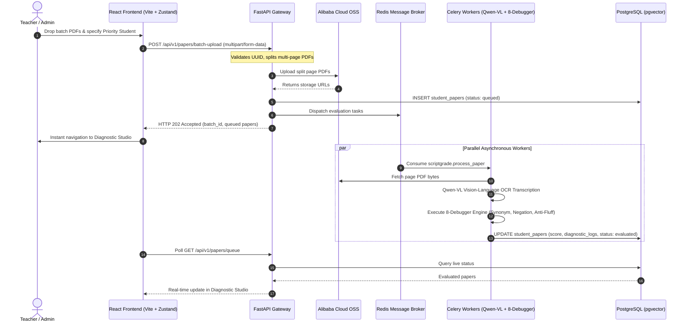

<div align="center">


# ScriptGrade
### *AI-Powered Diagnostic Grading Engine for Subjective Answer Sheets*
#### Understanding student intent — beyond context-blind OCR and human grading fatigue.

<br/>

[](#)
[](#)
[](#)
[](#)
[](#)
[](#)
[](#)
[](#)

<br/>

> 🏆 **Alibaba Cloud AI Hackathon Pakistan 2026 Submission**  
> *Track: Multi-Modal AI & Enterprise Educational Automation*  
> **Demo Account:** `demo@scriptgrade.pk` &bull; **Password:** `HackathonDemo2026`

</div>

---

## 📌 Executive Summary

Manual evaluation of handwritten subjective examination papers is fundamentally broken. Educators experience severe cognitive fatigue after grading dozens of open-ended scripts, leading to inconsistent scoring, human bias, and days of delayed grading turnaround. Conversely, rudimentary automated grading systems rely on naive string matching or unconstrained LLMs that succumb to keyword stuffing, miss critical semantic negations, and fail to distinguish meaningful answers from conversational filler.

**ScriptGrade** solves this crisis with an intent-aware, multi-modal diagnostic pipeline. Powered by **Alibaba Cloud DashScope (Qwen-VL and Qwen3.8-Max)** and an auditable **8-Debugger NLP Engine**, ScriptGrade transcribes handwritten scripts, isolates core conceptual entities, traps logical fallacies, filters redundant padding, and computes defensible scores with human-in-the-loop teacher moderation.

---

## ⚖️ The Problem vs. The ScriptGrade Solution

| Challenge in Traditional Grading | Naive AI / OCR Solutions | ScriptGrade Diagnostic Solution |
| :--- | :--- | :--- |
| **Grading Fatigue & Drift:** Markers grade harshly early on and leniently when exhausted. | Generic text generation prone to severe scoring hallucinations and inconsistency. | **Deterministic Rubric Aggregation:** Uniform diagnostic grading criteria applied equally across 10,000+ scripts. |
| **Keyword Stuffing ("Fluff"):** Students write long, irrelevant paragraphs containing scattered keywords to game grading. | Blindly rewards token presence regardless of conceptual density or syntactic coherence. | **Anti-Fluff Scorer:** Evaluates factual information density and relevance ratios, penalizing boilerplate padding. |
| **Polarity & Negation Reversals:** *"Mitochondria does NOT generate ATP"* scored identically to *"generates ATP"*. | Keyword matchers and basic vector distance treat negative and affirmative sentences as semantically identical. | **Negation Engine:** Traps syntax-level polarity inversions and flags semantic contradiction against the reference key. |
| **Vocabulary Variance:** Students use valid conceptual synonyms not verbatim in the answer key. | Penalizes students unfairly if their exact terminology deviates from the model answer. | **Synonym & Semantic Matcher:** Powered by `pgvector` embeddings to evaluate conceptual equivalence and semantic proximity. |
| **Turnaround Time & Logistics:** Manual grading takes weeks per examination cohort. | Disconnected desktop scripts incapable of handling physical batches or ADF scanners. | **Asynchronous Celery Pipeline:** Parallel OCR and multi-worker ingestion capable of processing entire exam cohorts in minutes. |

---

## 🧠 Core Innovation: The 8-Debugger NLP Engine

At the core of ScriptGrade is the **8-Debugger Diagnostic Architecture**. Rather than feeding raw OCR transcripts into a black-box prompt, ScriptGrade audits handwritten student answers across eight specialized evaluation layers:

```
                  ┌────────────────────────────────────────┐
                  │ Scanned Answer Sheet (PDF / ADF Image) │
                  └───────────────────┬────────────────────┘
                                      ▼
                  ┌────────────────────────────────────────┐
                  │ Alibaba Cloud DashScope (Qwen-VL OCR)  │
                  └───────────────────┬────────────────────┘
                                      ▼
                        Handwritten Transcript
                                      │
 ┌────────────────────────────────────┴────────────────────────────────────┐
 │                            THE 8-DEBUGGER SUITE                         │
 │                                                                         │
 │  ┌─────────────────────────┐  ┌─────────────────────────┐               │
 │  │ 1. Anti-Fluff Scorer    │  │ 2. Negation Engine      │  ★ ACTIVE     │
 │  │    (Relevance & Padding)│  │    (Polarity Detection) │    FRAMEWORKS │
 │  └─────────────────────────┘  └─────────────────────────┘               │
 │  ┌─────────────────────────┐  ┌─────────────────────────┐               │
 │  │ 3. Synonym Matcher      │  │ 4. Fuzzy Spelling       │               │
 │  │    (pgvector Cosine Sim)│  │    (Levenshtein DAG)    │               │
 │  └─────────────────────────┘  └─────────────────────────┘               │
 │  ┌─────────────────────────┐  ┌─────────────────────────┐               │
 │  │ 5. Sequence DAG         │  │ 6. Diagram Verification │               │
 │  │    (Procedural Flow)    │  │    (Visual Grounding)   │               │
 │  └─────────────────────────┘  └─────────────────────────┘               │
 │  ┌─────────────────────────┐  ┌─────────────────────────┐               │
 │  │ 7. Information Density  │  │ 8. Rubric Aggregator    │               │
 │  │    (Factual Hit Ratio)  │  │    (Audit & Overrides)  │               │
 │  └─────────────────────────┘  └─────────────────────────┘               │
 └────────────────────────────────────┬────────────────────────────────────┘
                                      ▼
          Auditable Diagnostics • Transparent Score Breakdown • Teacher Override
```

### 🔬 Deep Dive: The 3 Active Core Frameworks

#### 1. 🔄 Synonym & Semantic Matcher (`Debugger III`)
* **Objective:** Ensure fair scoring by recognizing valid conceptual equivalence even when the student uses alternative vocabulary or paraphrased explanations.
* **Mechanism:** Integrates `pgvector` cosine similarity embeddings. Each student token sequence is mapped against rubric target concepts in vector space. When similarity clears the validation threshold ($\ge 0.85$), the concept is resolved and credited with full contextual justification.

#### 2. 🚫 Negation Engine (`Debugger II`)
* **Objective:** Eliminate catastrophic false positives where a student includes target rubric terminology but negates the meaning (e.g., *"Chloroplasts do not synthesize glucose"*).
* **Mechanism:** Scans for structural negation triggers (`not`, `never`, `fails to`, `without`, `neither`, `cannot`) bound to target rubric entities. If an inversion is detected, the engine flags a polarity reversal, blocks false-positive mark awards, and records an explanation in the audit trace.

#### 3. 🧹 Anti-Fluff Scorer (`Debugger I — Garbage Text Classifier`)
* **Objective:** Protect academic integrity against "word-count padding" and verbatim regurgitation of exam question prompts.
* **Mechanism:** Calculates sentence-level relevance ratios against the reference answer. Sentences with a relevance ratio below the strict threshold ($< 0.35$) are flagged as filler text, suppressing superficial length bonuses and isolating genuine student responses.

---

## ⚡ Key Platform Features

### 1. Dual Ingestion Portal (Batch & Single Modes)
* **ADF Scanner & PDF Support:** Teachers can drop single answer sheets or large multi-page batch PDFs from Automatic Document Feeder (ADF) scanners (up to 200 MB per batch).
* **Smart Page Splitting:** The backend automatically splits multi-page PDFs into isolated student papers, allocating sequential roll identifiers (`STU-2026-001`, `STU-2026-002`) and streaming assets to Alibaba Cloud OSS.
* **Dynamic Mode Guardrails:** The Dropzone dynamically toggles its `multiple` attribute based on the active mode (`multiple=true` in Batch mode; single-item slicing in One-by-one mode).

### 2. Priority Evaluation Interceptor
* **Interactive Workflow Intercept:** In batch upload mode, the ingestion pipeline halts automated background submission and surfaces a centralized interceptor modal: *"Enter the name of the student to evaluate first."*
* **Filename Cross-Referencing:** Validates the input against staged file stems (case-insensitive, normalizing hyphens/spaces/underscores).
* **Fast-Track Execution:** If matched, the selected paper immediately bypasses the queue, dispatches to Qwen-VL workers, and transitions the view directly to the Diagnostic Studio for immediate evaluation. Unmatched inputs trigger a strict error alert: *"Alert: No student record found in the current batch."*

### 3. Diagnostic Studio Workspace
* **Split-Pane Review:** Displays the high-resolution scanned sheet (via an intersection-observer lazy-loaded viewer) side-by-side with the live OCR transcript and debugger metrics.
* **Active Frameworks Execution Status Panel:** Dedicated real-time indicators displaying live metrics for the 3 active frameworks:
  * **Synonym Matcher:** Concept resolution count and vector match details.
  * **Negation Engine:** Scanned token count and polarity inversion alerts.
  * **Anti-Fluff Scorer:** Relevance percentage and filler text status.
* **Instant Student Search Bar:** Header-level search input paired with an action button that cross-references student names and roll IDs in real time, allowing teachers to switch active student records instantly without leaving the workspace.
* **Human-in-the-Loop Override:** Fine-grained score adjustment slider with mandatory moderation audit notes.

---

## 🏗️ Technical Architecture & Data Flow



---

## 💻 Tech Stack & Cloud Infrastructure

### Alibaba Cloud Infrastructure
* **Alibaba Cloud DashScope:**
  * `qwen-vl-plus` / `qwen3.8-max`: Multi-modal Vision-Language model for transcribing complex handwriting, mathematical equations, and scientific terminology.
  * `qwen-plus`: Semantic reasoning and rubric extraction.
* **Alibaba Cloud OSS (Object Storage Service):**
  * Secure, scalable storage for scanned student sheets, cropped answer regions, and batch PDF archives.

### Backend & Asynchronous Pipeline
* **FastAPI (Python 3.10+):** Asynchronous REST gateway with strict Pydantic v2 schemas and OpenAPI documentation.
* **PostgreSQL & pgvector:** Relational metadata storage paired with vector extensions for semantic concept similarity search.
* **Celery & Redis:** Distributed task queue managing parallel OCR workers, decoupling heavy AI inference from HTTP request lifecycles.
* **pgserver:** Embedded zero-dependency PostgreSQL runner for seamless local hackathon judge evaluation.

### Frontend Engineering
* **React 19 & Vite:** Ultra-fast Single Page Application (SPA) with TanStack Start tooling.
* **Tailwind CSS v4:** Modern, responsive "Academic Monolith" design system with dark/light visual hierarchy.
* **Zustand:** Ultra-lean client-side state management for active papers, staging files, and authentication tokens.
* **TanStack React Query:** Optimistic updates, background queue polling, and query cache invalidation.

---

## 🚀 Local Setup & Installation

Follow these steps to run the complete ScriptGrade frontend and backend locally.

### Prerequisites
* **Python:** `3.10+` (Python 3.10 or 3.11 recommended)
* **Node.js:** `v18.0.0+` & `npm`
* **Git**

---

### Step 1: Clone the Repository
```bash
git clone https://github.com/musa8868973-web/ScriptGrade.git
cd ScriptGrade
```

---

### Step 2: Backend Setup

1. **Install Python Dependencies:**
   ```bash
   pip install -r backend/requirements.txt
   ```

2. **Configure Environment Variables:**
   A pre-configured development `.env` is provided at `backend/.env`. To enable live Alibaba Cloud services, populate your credentials:
   ```env
   # backend/.env
   DEBUG=true
   CORS_ORIGINS=["http://localhost:5173","http://127.0.0.1:5173"]

   # Alibaba Cloud OSS (leave blank for local storage fallback)
   OSS_ACCESS_KEY_ID=your_access_key_id
   OSS_ACCESS_KEY_SECRET=your_access_key_secret
   OSS_BUCKET_NAME=scriptgrade-scans
   OSS_ENDPOINT=oss-ap-southeast-1.aliyuncs.com

   # Alibaba Cloud DashScope (leave blank for deterministic PyMuPDF fallback)
   QWEN_API_KEY=your_dashscope_api_key
   QWEN_VL_MODEL=qwen-vl-plus
   QWEN_LLM_MODEL=qwen-plus
   ```

3. **Start the Embedded Backend & Database Runner:**
   ScriptGrade includes an all-in-one runner that spins up an embedded PostgreSQL instance, seeds default exams and users, and starts the FastAPI gateway:
   ```bash
   python run_backend.py
   ```
   * **API Gateway:** [http://localhost:8000](http://localhost:8000)
   * **Swagger Docs:** [http://localhost:8000/docs](http://localhost:8000/docs)
   * **Health Check:** [http://localhost:8000/health](http://localhost:8000/health)

---

### Step 3: Frontend Setup

1. **Install Dependencies:**
   ```bash
   cd frontend
   npm install
   ```

2. **Launch Development Server:**
   ```bash
   npm run dev
   ```
   * **Web Application:** [http://localhost:5173](http://localhost:5173)

---

### Step 4: Login with Pre-Seeded Hackathon Credentials

Navigate to [http://localhost:5173/login](http://localhost:5173/login) and use the pre-seeded account:
* **Email:** `demo@scriptgrade.pk`
* **Password:** `HackathonDemo2026`

*(Alternatively, click **"Quick Demo Access"** on the login page to authenticate instantly).*

---

## 📂 Repository Structure

```
ScriptGrade/
├── ScriptGrade_Logo.png            # High-resolution brand logo
├── run_backend.py                  # All-in-one local backend + Postgres runner
├── docs/                           # Architecture PRDs, documentation, UI mockups
│   ├── ScriptGrade_Backend_PRD_Ishmal.md
│   ├── ScriptGrade_Frontend_PRD_Rohail.md
│   └── ScriptGrade_NLP_AI_PRD_Musa.md
├── backend/                        # FastAPI microservice
│   ├── app/
│   │   ├── api/v1/                 # Endpoints: auth, exams, papers, analytics
│   │   ├── core/                   # Security, OAuth2, JWT dependencies
│   │   ├── models/                 # SQLAlchemy ORM models
│   │   ├── schemas/                # Pydantic v2 validation contracts
│   │   ├── services/               # 8-Debugger engine, batch ingestion, storage
│   │   └── workers/                # Celery background tasks & OCR pipeline
│   ├── requirements.txt            # Python dependencies
│   └── seed.py                     # Database initialization & sample rubric seeding
└── frontend/                       # Vite + React 19 SPA
    ├── public/                     # Static assets (ScriptGrade_Logo.png, samples)
    └── src/
        ├── components/
        │   ├── auth/               # Institutional authentication screen
        │   ├── debuggers/          # 8-Debugger detailed panels
        │   ├── layout/             # AppShell, responsive sidebar, topbar
        │   └── SheetViewer.tsx     # Lazy-loaded high-res scan viewer
        ├── lib/                    # API client, React Query hooks, types
        ├── routes/                 # TanStack file-based routes
        │   ├── ingestion.tsx       # Dual upload & Priority Interceptor
        │   ├── diagnostic-studio.tsx # Split-pane grading & student search
        │   └── dashboard.tsx       # Exam Hub & class analytics
        └── stores/                 # Zustand grade & auth stores
```

---

## 👥 Hackathon Team & Roles

* **Musa (Team Lead & NLP Architect):** Design of the 8-Debugger Diagnostic Suite, Qwen-VL prompt design, semantic negation handling, and information density scoring.
* **Ishmal (Backend Lead):** FastAPI gateway, PostgreSQL `pgvector` schemas, Celery distributed worker queue, and Alibaba Cloud OSS integration.
* **Rohail (Frontend Lead):** React 19 architecture, responsive AppShell, TanStack router integration, Diagnostic Studio workspace, and priority interceptor workflow.

---

<div align="center">
  <sub>Built with ❤️ for the <strong>Alibaba Cloud AI Hackathon Pakistan 2026</strong>.</sub>
</div>
